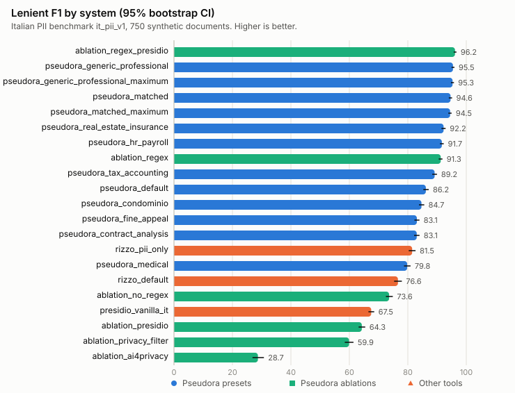
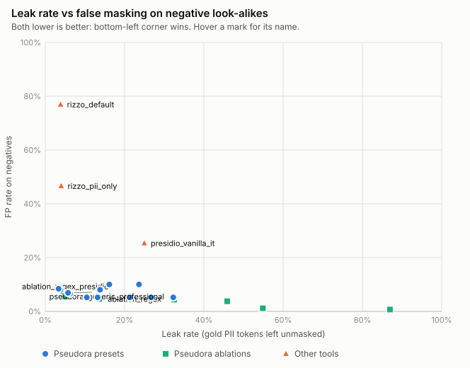
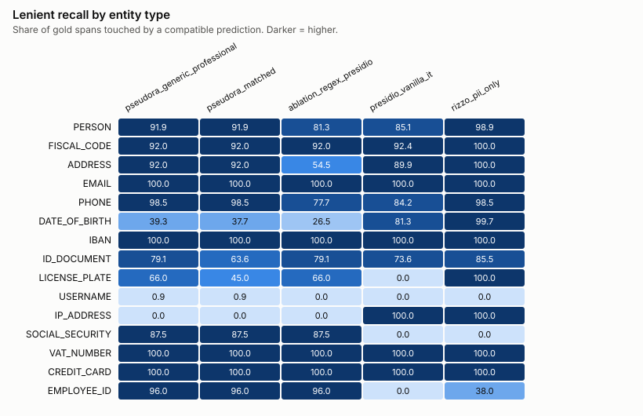

# Italian PII detection benchmark (`it_pii_v1`)

A reproducible benchmark of Italian PII detection on synthetic documents. It compares
the Pseudora engine (full pipeline, every domain preset, layer ablations) with vanilla
Microsoft Presidio and the one other open-source Italian anonymizer we could run locally.
It was written to find out where we are weak, not to produce a marketing number. Read the
limitations section before quoting any figure.

## Results at a glance

Engine at the detection-sprint commit (2026-11-01). The first row is the pre-sprint
reference from the original run, kept for comparison.

| System | Lenient F1 [95% CI] | Strict F1 [95% CI] | Leak rate [95% CI] | FP on negatives [95% CI] | ms / 1k chars |
|---|---|---|---|---|---|
| *Before the sprint:* Pseudora, `generic_professional` | 78.3 [77.2, 79.4] | 66.8 [65.6, 68.0] | 24.4 [23.1, 25.8] | 15.6 [14.2, 17.1] | 331 |
| Pseudora, `generic_professional` preset (reference, `balanced`) | 95.5 [95.0, 96.0] | 90.6 [89.7, 91.4] | 3.9 [3.1, 4.7] | 8.1 [7.0, 9.2] | 329 |
| Pseudora, `generic_professional`, `protection_level=maximum` | 95.3 [94.8, 95.8] | 90.9 [90.1, 91.6] | **3.4** [2.6, 4.2] | 8.4 [7.3, 9.6] | 320 |
| Pseudora, preset matched to genre | 94.6 [94.0, 95.2] | 89.7 [88.8, 90.5] | 6.2 [5.2, 7.2] | 6.5 [5.5, 7.6] | 325 |
| Ablation: regex+checksum + Presidio/spaCy only | **96.2** [95.7, 96.7] | **91.6** [90.8, 92.3] | 5.1 [4.2, 6.0] | 5.6 [4.8, 6.5] | 35 |
| Vanilla Presidio, Italian spaCy | 67.5 [66.5, 68.5] | 52.3 [51.3, 53.3] | 25.0 [23.9, 26.2] | 25.3 [23.6, 27.0] | 18 |
| Rizzo-PII, `pii_only` config | 81.5 [80.3, 82.6] | 59.8 [58.7, 60.9] | 4.0 [3.4, 4.7] | 46.6 [44.6, 48.6] | 215 |

All values are percentages. The leak rate is the share of gold PII word tokens left unmasked,
whatever label the system used: lower is better, and it is the number that matters most for
a redaction product. "FP on negatives" is the share of non-PII look-alikes (dates of a document,
amounts, law references, protocol numbers, company names, public bodies) that got masked: lower
is better. The full tables, with every system and breakdowns by type, genre and hard case, are
[below](#full-results).





## What changed, and where Pseudora still loses

**Read this first: the sprint was tuned against this corpus.** The recognizers added on
2026-11-01 (birth data, IP, case numbers, plates, usernames, cue-based names, key/value logs,
spaced and OCR-damaged codes, full addresses, cadastral references) and the ML precision
filter were written after an error analysis of these 750 synthetic documents. The jump from
24.4% to 3.9% leak is real on this corpus, but part of it is fitting to templates we wrote
ourselves. Expect a much smaller gain on real documents until a held-out corpus exists.

- **Leakage now matches Rizzo-PII, with far less false masking.** `balanced` leaks 3.9%
  (Rizzo `pii_only` 4.0%; paired difference −0.4 to +0.8 points, so no significant gap) and
  masks 8.1% of negative look-alikes against Rizzo's 46.6%.
- **`maximum` buys little on this corpus.** It lowers the ML cut-offs, keeps more low-score
  ML spans and adds looser address rules: leak −0.3 to −0.6 points, negative FP +0.3. Most
  of its extra recall shows up in indirect identifiers (3% to 31%), which are rare here.
- **The transformers no longer earn their cost here.** Regex+checksum with Presidio/spaCy
  alone has a slightly higher F1 (+0.4 to +1.0 lenient) at about one tenth of the latency.
  It leaks 0.9 to 1.5 points more. On this corpus most of the gain came from deterministic
  rules; we keep the transformers because real documents vary more than our templates.
- **Indirect identifiers** ("the tenant on the third floor") are still at 3% recall in
  `balanced`; Rizzo and vanilla Presidio reach over 90% only by masking almost everything.
- **Residual leaks:** `ADDRESS` 4%, `PERSON` 4%, `EMPLOYEE_ID` 4%. Negative look-alikes still
  masked: 43 common words used as names and 30 document/protocol numbers (the generic preset
  protects `TAX_DOCUMENT_ID` on purpose).
- **Domain presets other than generic remain weaker on this mixed corpus** (5 to 17 points
  of lenient F1 lower). That is partly by design, since they keep more types visible.
- **Latency is not a strength.** We take 320–350 ms per 1k characters on a 6-CPU Docker VM
  without a GPU, against 18 ms for vanilla Presidio and about 215 ms for Rizzo. The 2.4–3.4x
  preset slowdown seen in the first run did not reproduce; treat latency as indicative only.

## Systems

| Id | What it is | How it was run |
|---|---|---|
| `pseudora_<preset>` | Full engine pipeline (regex+checksum, Presidio/spaCy, privacy-filter and ai4privacy transformers, merger, denylist, snapping) with one of the 9 domain presets | Engine HTTP `/v1/anonymize` with `dry_run`, ephemeral PostgreSQL. The current `api/` source is mounted read-only, models load offline, and all detector layers must report ready. Only masked spans are scored. |
| `pseudora_<preset>_maximum` | Same pipeline with `protection_level=maximum` (lower ML cut-offs, relaxed precision filter, looser address rules); run for `generic_professional` and `matched` | as above |
| `pseudora_matched` | Same pipeline; each document uses the preset a user would choose for its genre (no litigation preset exists, so court documents use `generic_professional`) | as above |
| `ablation_<layers>` | `generic_professional` policy with detection limited to the listed layers (`context_types.detection_layers`) | as above |
| `presidio_vanilla_it` | Microsoft Presidio `AnalyzerEngine` with `it_core_news_lg`, default recognizers and threshold. Every result counts as masked. | inside the engine image |
| `rizzo_default`, `rizzo_pii_only` | [Rizzo-AI-Academy/rizzo-pii](https://github.com/Rizzo-AI-Academy/rizzo-pii) (MIT) at `9057eeff`, model `rizzoaiacademy/rizzo-pii-0.3B` rev `a1c3c838`, through its own `analyze()`. `default` excludes AGE and GENDER; `pii_only` also excludes AMOUNT and ORG (the app's own setting). | inside the engine image, upstream code unchanged |

**Not tested**, with the reason:

- **Cloud APIs** (AWS Comprehend, Google Cloud DLP, Azure AI Language PII, Private AI,
  Nightfall): they are not locally runnable, they would need sending the corpus to a third
  party, and some terms restrict publishing benchmarks.
- **GLiNER PII models** (e.g. `urchade/gliner_multi_pii-v1`, Apache-2.0): they could run
  locally but were not included in this iteration. This is the first follow-up.
- **spaCy `it_core_news_lg` NER alone**: covered in practice by `ablation_presidio` and
  `presidio_vanilla_it`, which wrap it.
- **Italian anonymizers without released code or weights, or with a non-commercial or unclear
  licence**: we did not run them. We only benchmark tools we can legally run and redistribute
  results for.

## Dataset

`dataset/it_pii_v1.jsonl` has **750 synthetic documents** (279k characters). It is generated
deterministically by `generate.py` (seed `20261026`, SHA-256 `1466a601…`) and released under
CC BY 4.0 (`dataset/LICENSE.md`).

- **Genres:** legal 150 (citazioni, sentenze, procure, ricorsi, contratti di locazione), HR 100,
  tax 100, real estate / insurance 100, email and support tickets 85, chat / LLM prompts 90,
  logs and JSON 70, and 55 documents that contain no PII at all. 60 documents carry simulated
  OCR noise.
- **4,600 gold PII spans in 20 types:** PERSON 1,399, FISCAL_CODE 537, ADDRESS 398, EMAIL 385,
  DATE_OF_BIRTH 321, BIRTH_PLACE 272, PHONE 260, IBAN 168, ID_DOCUMENT 110, USERNAME 110,
  LICENSE_PLATE 100, CADASTRAL_REF 82, CASE_ID 79, CONTRACT_ID 74, IP_ADDRESS 70,
  SOCIAL_SECURITY 56, EMPLOYEE_ID 50, VAT_NUMBER 50, CREDIT_CARD 50, INDIRECT 29.
  Identifiers are checksum-valid (codice fiscale with omocodia, IBAN, partita IVA, Luhn).
- **2,766 negative look-alike spans** that must not be masked: document dates 682, amounts 636,
  law references 446, protocol and document numbers 334, codes 273, companies 185, public
  bodies 175, common words that are also surnames 35.
- **Tagged hard cases:** lowercase names, uppercase surnames, surname-first order, foreign
  names, ambiguous words (Rosa, Bianco…), initials, spaced or hyphenated values, OCR-damaged
  values, PEC addresses, abbreviations, rural addresses, omocodia, nicknames, indirect
  identifiers.

## Metrics

- **Strict:** exact start and end with a compatible type, matched one-to-one.
- **Lenient:** any overlap with a compatible type (recall per gold span, precision per
  predicted span).
- **Compatible types** are declared in `taxonomy.json`. Each system's labels are mapped to
  canonical types, and a generic class (e.g. `DATE`) is accepted for a finer gold type
  (`DATE_OF_BIRTH`).
- **Leak rate:** gold word tokens not fully covered by any masked span, whatever the label.
- **FP on negatives:** negative look-alike spans overlapped by any masked span.
- **Direct view:** `ci95_direct` in `summary.json` repeats the metrics with quasi-identifiers
  (BIRTH_PLACE, CASE_ID, CONTRACT_ID, CADASTRAL_REF, INDIRECT) treated as "ignore" regions. In
  that view Pseudora's lenient F1 is 81.9 and its leak rate 20.6; Rizzo's are 80.4 and 2.8.
- **Uncertainty:** 1,000 bootstrap resamples over documents. Every difference against the
  reference is paired (the same resample for both systems).
- **Latency:** wall-clock time per document over HTTP or the in-process call, summed and
  divided per 1k characters. It was measured on one machine (Docker VM with 6 CPUs and 8 GB,
  aarch64, no GPU), with systems run one after another.

## Reproduce

Scoring and charts need only Python 3.11 and the standard library. They are rebuilt from the
committed predictions, and CI does this on every PR and fails on any drift:

```bash
python3 benchmark/italian/score.py && python3 benchmark/italian/report.py
python3 -m pytest benchmark/italian/tests -q        # generator, scorer and report tests
python3 benchmark/italian/generate.py --check       # dataset regenerates byte-for-byte
```

Re-running every system needs Docker, the engine image built from `api/Dockerfile`, and a
Hugging Face cache volume holding the engine's pinned models (the same setup as
`scripts/check-engine-local.py`). The Rizzo-PII systems also need a checkout at the pinned
commit and a volume with the pinned weights:

```bash
python3 benchmark/italian/run.py --image docjobs-engine:base --cache-volume docjobs-hf \
    --rizzo-src ../rizzo-pii --rizzo-model-volume rizzo-models
# quick smoke run: first 2 documents of each sub-genre, written to results-subset/
python3 benchmark/italian/run.py --image docjobs-engine:base --cache-volume docjobs-hf \
    --subset 2 --systems pseudora_generic_professional,ablation_regex,presidio_vanilla_it
```

On the machine described above the measured detection time for all 21 systems adds up to about 35 minutes, plus model loading. Every container uses a
`bench-it-<random>` prefix and is removed when the run ends.

## Limitations

- **The engine was tuned on this corpus** (see above). A held-out set written by someone
  else is the next step before any figure is quoted externally.
- **The data is synthetic.** The templates were written by the same team that builds the
  engine. Even though the gold spans were fixed before any system was run, the corpus is
  likely to favour patterns we already thought of. Real documents will be messier, and the
  absolute numbers will probably be lower for every system.
- **Label mapping matters.** Strict and lenient F1 depend on `taxonomy.json`. The leak rate
  does not, which is why it is shown next to F1.
- **No production traffic or GPU.** The engine ran with production code and models but on a
  laptop-class Docker VM. Latency on production hardware will differ.
- **The two external tools were run with their published defaults.** Neither was tuned. Rizzo's
  `pii_only` setting comes from its own UI. Our presets are the ones we ship.
- **The FP rate on negatives depends on what we call a look-alike.** For example, Rizzo masks
  every date by design, which some users want.

## Full results

<!-- results:start -->
Dataset `it_pii_v1.jsonl` · 750 documents · bootstrap 1000 resamples over documents · all values in %.

### Overall

| System | Strict F1 [95% CI] | Lenient P | Lenient R | Lenient F1 [95% CI] | Leak rate [95% CI] | FP on negatives [95% CI] | ms / 1k chars |
|---|---|---|---|---|---|---|---|
| `ablation_regex_presidio` | 91.6 [90.8, 92.3] | 95.9 | 96.4 | **96.2** [95.7, 96.7] | 5.1 [4.2, 6.0] | 5.6 [4.8, 6.5] | 35.25 |
| `pseudora_generic_professional` | 90.6 [89.7, 91.4] | 93.2 | 97.8 | **95.5** [95.0, 96.0] | 3.9 [3.1, 4.7] | 8.1 [7.0, 9.2] | 328.71 |
| `pseudora_generic_professional_maximum` | 90.9 [90.1, 91.6] | 92.7 | 98.0 | **95.3** [94.8, 95.8] | 3.4 [2.6, 4.2] | 8.4 [7.3, 9.6] | 320.13 |
| `pseudora_matched` | 89.7 [88.8, 90.5] | 93.9 | 95.3 | **94.6** [94.0, 95.2] | 6.2 [5.2, 7.2] | 6.5 [5.5, 7.6] | 324.53 |
| `pseudora_matched_maximum` | 90.0 [89.2, 90.8] | 93.4 | 95.6 | **94.5** [93.9, 95.0] | 5.7 [4.8, 6.7] | 6.9 [5.9, 8.0] | 325.07 |
| `pseudora_real_estate_insurance` | 87.1 [86.2, 87.9] | 94.5 | 90.1 | **92.2** [91.5, 92.9] | 10.5 [9.3, 11.6] | 5.2 [4.4, 6.1] | 323.65 |
| `pseudora_hr_payroll` | 86.5 [85.6, 87.3] | 94.4 | 89.0 | **91.7** [91.0, 92.3] | 13.2 [12.0, 14.5] | 5.2 [4.4, 6.1] | 330.32 |
| `ablation_regex` | 89.8 [89.0, 90.5] | 96.6 | 86.5 | **91.3** [90.6, 91.9] | 13.6 [12.5, 14.8] | 4.6 [3.9, 5.3] | 16.37 |
| `pseudora_tax_accounting` | 84.0 [83.0, 84.9] | 92.5 | 86.1 | **89.2** [88.3, 90.0] | 13.8 [12.4, 15.2] | 8.1 [7.0, 9.2] | 328.71 |
| `pseudora_default` | 81.2 [80.1, 82.3] | 86.5 | 85.9 | **86.2** [85.3, 87.1] | 16.2 [14.9, 17.4] | 10.0 [9.0, 11.0] | 326.39 |
| `pseudora_condominio` | 79.5 [78.4, 80.5] | 88.7 | 81.0 | **84.7** [83.8, 85.6] | 21.3 [20.0, 22.6] | 5.2 [4.4, 6.1] | 342.47 |
| `pseudora_fine_appeal` | 77.6 [76.5, 78.6] | 93.4 | 74.8 | **83.1** [82.3, 84.0] | 26.7 [25.2, 28.1] | 5.2 [4.4, 6.1] | 341.35 |
| `pseudora_contract_analysis` | 77.7 [76.6, 78.7] | 90.3 | 76.9 | **83.1** [82.2, 84.0] | 23.7 [22.2, 25.0] | 10.0 [9.0, 11.0] | 324.22 |
| `rizzo_pii_only` | 59.8 [58.7, 60.9] | 71.9 | 93.9 | **81.5** [80.3, 82.6] | 4.0 [3.4, 4.7] | 46.6 [44.6, 48.6] | 214.89 |
| `pseudora_medical` | 74.1 [72.8, 75.3] | 93.1 | 69.8 | **79.8** [78.7, 80.9] | 32.3 [30.5, 34.1] | 5.2 [4.4, 6.1] | 349.25 |
| `rizzo_default` | 55.9 [54.8, 57.0] | 64.7 | 93.9 | **76.6** [75.3, 78.0] | 3.9 [3.2, 4.5] | 76.9 [74.8, 78.7] | 218.59 |
| `ablation_no_regex` | 63.4 [62.1, 64.7] | 86.1 | 64.3 | **73.6** [72.5, 74.9] | 32.5 [30.9, 34.2] | 4.4 [3.6, 5.2] | 319.08 |
| `presidio_vanilla_it` | 52.3 [51.3, 53.3] | 59.2 | 78.5 | **67.5** [66.5, 68.5] | 25.0 [23.9, 26.2] | 25.3 [23.6, 27.0] | 17.72 |
| `ablation_presidio` | 58.6 [57.5, 60.0] | 93.6 | 48.9 | **64.3** [63.2, 65.4] | 54.9 [53.4, 56.3] | 1.2 [0.8, 1.6] | 39.7 |
| `ablation_privacy_filter` | 50.2 [48.8, 51.6] | 83.2 | 46.8 | **59.9** [58.4, 61.4] | 45.9 [44.0, 47.7] | 3.8 [3.1, 4.5] | 304.56 |
| `ablation_ai4privacy` | 13.7 [12.2, 15.3] | 90.4 | 17.1 | **28.7** [26.9, 30.8] | 86.9 [85.7, 88.1] | 0.7 [0.4, 1.0] | 121.49 |

### Difference vs `pseudora_generic_professional` (paired bootstrap, 95% CI; positive leak delta = leaks more)

| System | Δ strict F1 | Δ lenient F1 | Δ leak rate |
|---|---|---|---|
| `ablation_regex_presidio` | [0.7, 1.4] | [0.4, 1.0] | [0.9, 1.5] |
| `pseudora_generic_professional_maximum` | [-0.0, 0.6] | [-0.3, -0.0] | [-0.6, -0.3] |
| `pseudora_matched` | [-1.3, -0.5] | [-1.2, -0.5] | [1.7, 3.0] |
| `pseudora_matched_maximum` | [-1.1, -0.1] | [-1.4, -0.6] | [1.2, 2.6] |
| `pseudora_real_estate_insurance` | [-4.1, -2.9] | [-3.8, -2.7] | [5.7, 7.6] |
| `pseudora_hr_payroll` | [-4.6, -3.5] | [-4.3, -3.3] | [8.4, 10.3] |
| `ablation_regex` | [-1.4, -0.2] | [-4.8, -3.6] | [9.0, 10.6] |
| `pseudora_tax_accounting` | [-7.2, -5.9] | [-6.9, -5.6] | [8.8, 11.1] |
| `pseudora_default` | [-10.2, -8.6] | [-10.1, -8.5] | [11.2, 13.3] |
| `pseudora_condominio` | [-12.0, -10.2] | [-11.6, -9.9] | [16.3, 18.6] |
| `pseudora_fine_appeal` | [-13.8, -12.2] | [-13.1, -11.5] | [21.5, 24.1] |
| `pseudora_contract_analysis` | [-13.7, -12.1] | [-13.2, -11.6] | [18.4, 21.1] |
| `rizzo_pii_only` | [-32.0, -29.5] | [-15.0, -12.8] | [-0.4, 0.8] |
| `pseudora_medical` | [-17.6, -15.5] | [-16.7, -14.7] | [26.7, 30.2] |
| `rizzo_default` | [-36.0, -33.5] | [-20.0, -17.6] | [-0.6, 0.6] |
| `ablation_no_regex` | [-28.4, -25.9] | [-23.0, -20.7] | [27.1, 30.2] |
| `presidio_vanilla_it` | [-39.4, -37.2] | [-29.0, -26.9] | [20.0, 22.3] |
| `ablation_presidio` | [-33.2, -30.5] | [-32.3, -30.0] | [49.5, 52.4] |
| `ablation_privacy_filter` | [-41.9, -38.9] | [-37.0, -34.0] | [40.1, 43.9] |
| `ablation_ai4privacy` | [-78.5, -75.0] | [-68.6, -64.6] | [81.6, 84.4] |

### Lenient recall by entity type (leak rate in parentheses)

| Type (gold spans) | `pseudora_generic_professional` | `pseudora_matched` | `ablation_regex_presidio` | `presidio_vanilla_it` | `rizzo_pii_only` |
|---|---|---|---|---|---|
| PERSON (1399) | 96.9 (4.2) | 96.9 (4.2) | 93.6 (7.4) | 85.1 (13.2) | 98.9 (1.8) |
| FISCAL_CODE (537) | 99.4 (0.5) | 99.4 (0.5) | 99.4 (0.2) | 92.4 (13.0) | 100.0 (0.0) |
| ADDRESS (398) | 98.5 (4.2) | 98.5 (4.2) | 94.7 (6.0) | 89.9 (44.3) | 100.0 (0.1) |
| EMAIL (385) | 100.0 (0.0) | 100.0 (0.0) | 100.0 (0.0) | 100.0 (0.0) | 100.0 (0.0) |
| DATE_OF_BIRTH (321) | 99.4 (0.6) | 90.0 (10.0) | 99.1 (0.9) | 81.3 (18.7) | 99.7 (0.0) |
| BIRTH_PLACE (272) | 99.6 (0.0) | 99.6 (0.0) | 99.6 (0.4) | 93.0 (7.0) | 98.5 (1.5) |
| PHONE (260) | 99.6 (0.2) | 99.6 (0.2) | 99.6 (0.2) | 84.2 (13.6) | 98.5 (4.8) |
| IBAN (168) | 100.0 (0.0) | 100.0 (0.0) | 100.0 (0.0) | 100.0 (0.0) | 100.0 (0.0) |
| ID_DOCUMENT (110) | 97.3 (0.0) | 76.4 (19.3) | 97.3 (0.0) | 73.6 (21.0) | 85.5 (1.7) |
| USERNAME (110) | 98.2 (0.0) | 98.2 (0.0) | 98.2 (1.1) | 0.0 (96.1) | 0.0 (100.0) |
| LICENSE_PLATE (100) | 97.0 (0.9) | 67.0 (28.9) | 97.0 (0.9) | 0.0 (83.1) | 100.0 (0.0) |
| CADASTRAL_REF (82) | 100.0 (0.0) | 63.4 (36.6) | 100.0 (0.0) | 0.0 (89.0) | 100.0 (0.0) |
| CASE_ID (79) | 100.0 (0.0) | 100.0 (0.0) | 100.0 (0.0) | 0.0 (98.7) | 100.0 (0.0) |
| CONTRACT_ID (74) | 100.0 (0.0) | 100.0 (0.0) | 100.0 (0.0) | 0.0 (58.6) | 44.6 (0.7) |
| IP_ADDRESS (70) | 100.0 (0.0) | 100.0 (0.0) | 100.0 (0.0) | 100.0 (0.0) | 100.0 (0.0) |
| SOCIAL_SECURITY (56) | 87.5 (0.0) | 87.5 (0.0) | 87.5 (0.0) | 0.0 (16.7) | 0.0 (32.1) |
| CREDIT_CARD (50) | 100.0 (0.0) | 100.0 (0.0) | 100.0 (0.0) | 100.0 (0.0) | 100.0 (0.0) |
| EMPLOYEE_ID (50) | 96.0 (4.0) | 96.0 (4.0) | 96.0 (4.0) | 0.0 (98.0) | 38.0 (0.0) |
| VAT_NUMBER (50) | 100.0 (0.0) | 100.0 (0.0) | 100.0 (0.0) | 100.0 (0.0) | 100.0 (0.0) |
| INDIRECT (29) | 3.4 (99.0) | 3.4 (99.0) | 0.0 (100.0) | 96.6 (76.0) | 93.1 (76.4) |

### Lenient F1 by genre (FP rate on negative look-alikes in parentheses)

| Genre | `pseudora_generic_professional` | `pseudora_matched` | `ablation_regex_presidio` | `presidio_vanilla_it` | `rizzo_pii_only` |
|---|---|---|---|---|---|
| chat_prompt | 90.6 (5.0) | 90.6 (5.0) | 91.8 (0.0) | 73.6 (37.5) | 91.9 (30.0) |
| email_ticket | 98.9 (1.6) | 98.9 (1.6) | 97.2 (0.8) | 75.1 (20.4) | 89.9 (36.0) |
| hr | 93.0 (7.2) | 94.5 (2.7) | 93.1 (6.7) | 61.4 (24.8) | 73.1 (37.9) |
| legal | 98.2 (2.0) | 93.5 (2.0) | 98.1 (0.2) | 72.6 (25.2) | 92.7 (41.7) |
| logs_json | 94.9 (15.1) | 94.9 (15.1) | 96.3 (13.1) | 61.6 (52.7) | 58.9 (84.9) |
| negative | – (11.0) | – (11.0) | – (8.6) | – (24.4) | – (45.9) |
| real_estate_insurance | 95.8 (10.3) | 97.2 (3.4) | 97.8 (6.9) | 62.6 (22.6) | 80.9 (49.1) |
| tax | 95.7 (10.8) | 95.7 (10.8) | 97.4 (5.5) | 70.6 (13.8) | 82.4 (46.8) |

### Negative look-alikes wrongly masked (lower is better)

| Look-alike (spans) | `pseudora_generic_professional` | `pseudora_matched` | `ablation_regex_presidio` | `presidio_vanilla_it` | `rizzo_pii_only` |
|---|---|---|---|---|---|
| CODE (273) | 4.4 | 4.4 | 2.9 | 9.9 | 74.4 |
| COMMON_WORD (35) | 42.9 | 42.9 | 42.9 | 42.9 | 17.1 |
| DOC_DATE (682) | 3.5 | 3.5 | 3.5 | 65.7 | 100.0 |
| DOC_NUMBER (334) | 29.9 | 17.4 | 30.5 | 13.8 | 83.5 |
| LAW_REF (446) | 1.3 | 1.3 | 0.2 | 11.0 | 14.1 |
| MONEY (636) | 2.2 | 2.2 | 0.0 | 1.9 | 5.3 |
| ORG (185) | 12.4 | 12.4 | 2.7 | 43.8 | 0.0 |
| PUBLIC_BODY (175) | 16.6 | 16.6 | 0.0 | 13.1 | 12.6 |

Documents with no PII at all that got at least one mask: `pseudora_generic_professional` 56.4, `pseudora_matched` 56.4, `ablation_regex_presidio` 50.9, `presidio_vanilla_it` 94.5, `rizzo_pii_only` 100.0.

### Hard cases (lenient recall)

| Hard case (spans) | `pseudora_generic_professional` | `pseudora_matched` | `ablation_regex_presidio` | `presidio_vanilla_it` | `rizzo_pii_only` |
|---|---|---|---|---|---|
| lowercase (235) | 92.8 | 92.8 | 86.4 | 78.3 | 99.1 |
| uppercase_surname (185) | 96.8 | 96.8 | 96.2 | 73.5 | 100.0 |
| surname_first (160) | 96.2 | 96.2 | 95.6 | 91.2 | 99.4 |
| foreign (155) | 94.8 | 94.8 | 92.3 | 85.8 | 96.1 |
| ambiguous_word (124) | 90.3 | 90.3 | 87.9 | 75.0 | 96.0 |
| initial (111) | 99.1 | 99.1 | 96.4 | 92.8 | 91.9 |
| spaced (100) | 100.0 | 100.0 | 100.0 | 64.0 | 100.0 |
| ocr_value (89) | 91.0 | 89.9 | 87.6 | 70.8 | 91.0 |
| abbreviated (84) | 97.6 | 97.6 | 84.5 | 95.2 | 100.0 |
| pec (84) | 100.0 | 100.0 | 100.0 | 100.0 | 100.0 |
| uppercase (37) | 100.0 | 100.0 | 100.0 | 59.5 | 100.0 |
| rural (34) | 100.0 | 100.0 | 100.0 | 100.0 | 100.0 |
| indirect (29) | 3.4 | 3.4 | 0.0 | 96.6 | 93.1 |
| omocodia (29) | 100.0 | 100.0 | 100.0 | 96.6 | 100.0 |
| nickname (22) | 90.9 | 90.9 | 86.4 | 86.4 | 86.4 |
<!-- results:end -->
